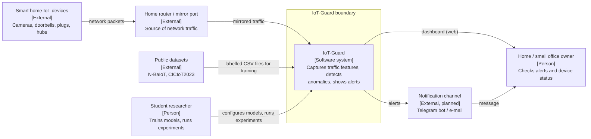
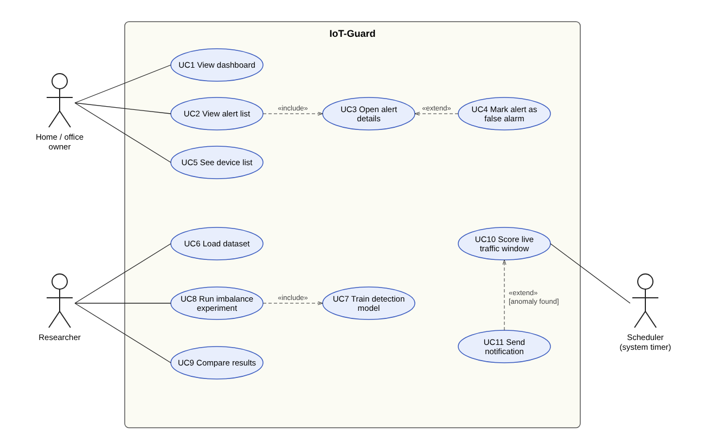
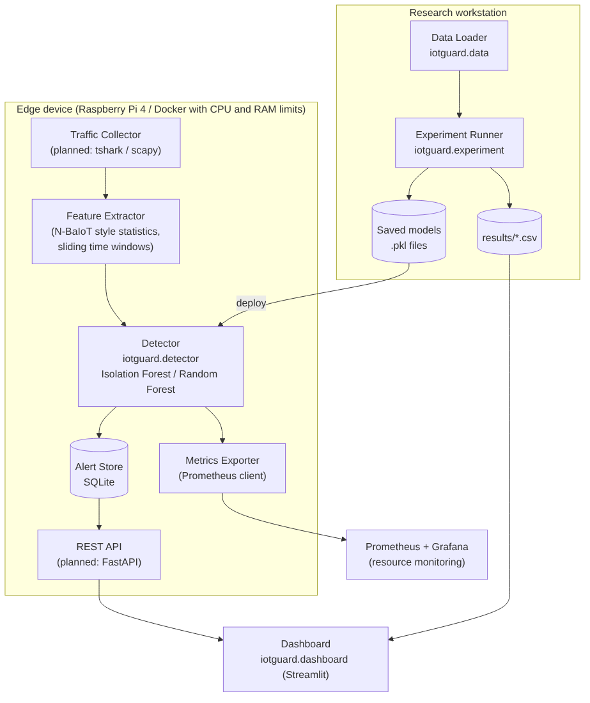
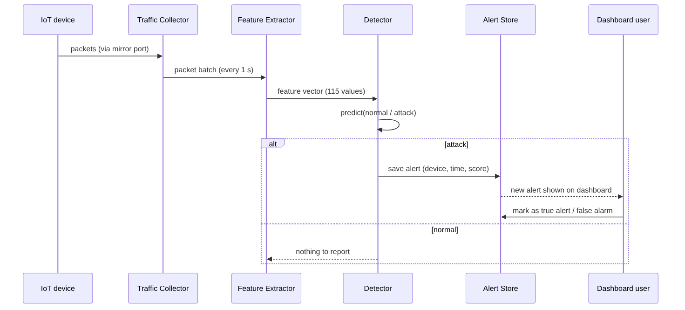

# 7. Architecture and Diagrams

All diagram sources are editable and stored in [`diagrams/src`](../diagrams/src). Mermaid files (`.mmd`) can be edited on GitHub or at https://mermaid.live, the use case diagram is an SVG that opens in draw.io or Inkscape. PNG exports are in [`diagrams/png`](../diagrams/png).

## 7.1 System context

IoT-Guard sits next to the home router and gets a copy of the traffic (port mirroring or a Raspberry Pi acting as a bridge). It does not need access to the devices themselves. Public datasets are used only for training and for the experiments. The owner sees alerts on the dashboard; a Telegram bot is planned as the notification channel.

## 7.2 Use case diagram

Actors: the home / office owner (monitoring), the researcher (training and experiments) and a scheduler that triggers scoring of each traffic window. Use cases map to requirements: UC1 to UC3 → FR-5, FR-6; UC4 → FR-8; UC5 → FR-10; UC6 → FR-1; UC7 → FR-3; UC8, UC9 → FR-2, FR-4, FR-7; UC10 → FR-9; UC11 → FR-11.

## 7.3 Component diagram (draft)

| Component | Responsibility | Status |
| --- | --- | --- |
| Data Loader (`iotguard.data`) | Read N-BaIoT CSV files, label them, build imbalanced subsets | Implemented |
| Detector (`iotguard.detector`) | Build, train and run IForest / RF; measure metrics and resources | Implemented |
| Experiment Runner (`iotguard.experiment`) | Loop over ratios and models, save results CSV | Implemented |
| Dashboard (`iotguard.dashboard`) | Alerts page and experiment page (Streamlit) | Implemented (prototype) |
| Traffic Collector | Capture packets from mirror port (tshark / scapy) | Planned, pre-defense 2 |
| Feature Extractor | Turn packets into N-BaIoT style window statistics | Planned, pre-defense 2 |
| Alert Store | SQLite table of alerts and user feedback | Planned, pre-defense 2 |
| REST API | FastAPI between detector and dashboard | Planned |
| Metrics Exporter | Expose CPU / memory to Prometheus during experiments | Planned |

## 7.4 Main scenario: from traffic to alert

## 7.5 Data

- Input features: 115 statistical features per time window from N-BaIoT (packet size, count, jitter and direction statistics over 5 time decay windows). No payloads.
- Label: 0 normal, 1 attack (from the file name in N-BaIoT).
- Alert record (planned): `id, device_ip, device_mac, timestamp, model, score, status(new/true/false_alarm)`.

## 7.6 Consistency check

| Requirement | Use case | Component |
| --- | --- | --- |
| FR-1, FR-2 | UC6 | Data Loader |
| FR-3 | UC7 | Detector |
| FR-4, FR-7 | UC8, UC9 | Experiment Runner, Dashboard |
| FR-5, FR-6 | UC1, UC2, UC3 | Dashboard |
| FR-8 | UC4 | Alert Store, Dashboard |
| FR-9 | UC10 | Traffic Collector, Feature Extractor, Detector |
| FR-10 | UC5 | Feature Extractor, Dashboard |
| FR-11 | UC11 | Notification (planned) |
