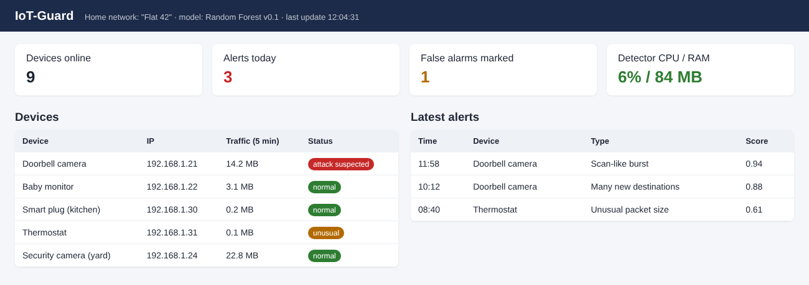
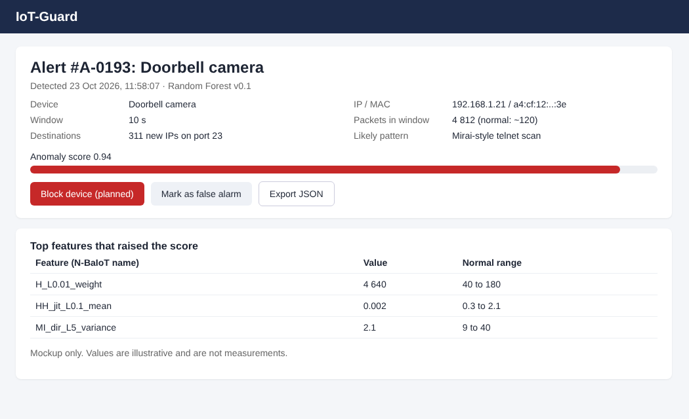
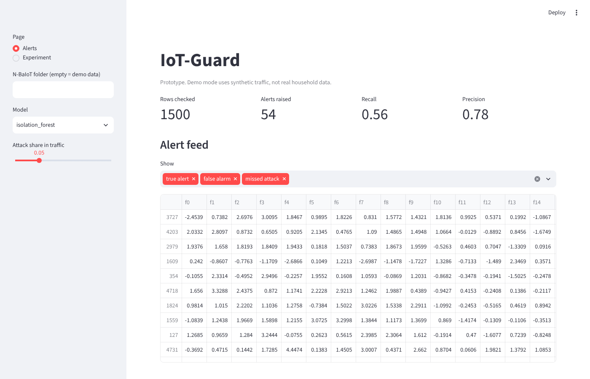
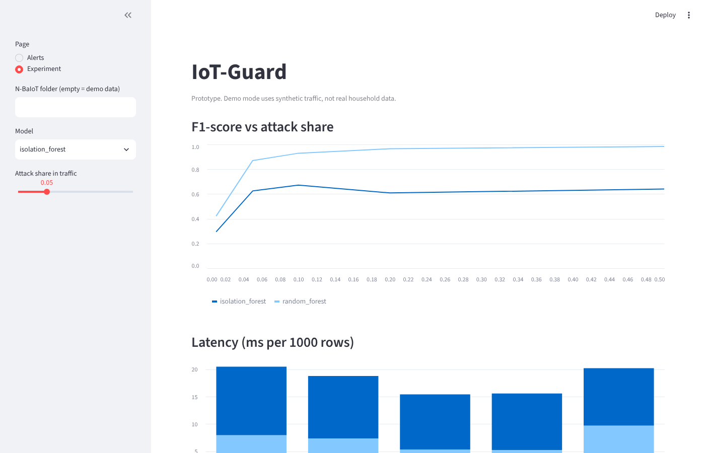

# 8. UX and Prototype

There are two kinds of material here:

1. **Mockups** of the target screens for the home / office owner (what the final product should look like).
2. **A working prototype** in Python that already trains the models, raises alerts on test traffic and shows experiment results.

## 8.1 Key user scenarios

| # | Scenario | Screen |
| --- | --- | --- |
| S1 | Owner opens the dashboard and checks if everything is fine | Overview |
| S2 | Owner sees a red device and opens the alert to understand what happened | Alert details |
| S3 | Owner decides the alert is a false alarm and marks it | Alert details |
| S4 | Researcher runs the imbalance experiment and compares models | Prototype, Experiment page |

## 8.2 Mockups (target design)

Sources: [`prototype/mockups/overview.html`](../prototype/mockups/overview.html), [`prototype/mockups/alert-details.html`](../prototype/mockups/alert-details.html) (open in any browser and edit).

**Overview (S1).** Status cards, list of devices with a colour status and the latest alerts.



**Alert details (S2, S3).** What was detected, on which device, score, top features and actions.



Values in the mockups are illustrative, not measurements.

## 8.3 Working prototype

Code: [`src/iotguard`](../src/iotguard). How to run: see the README.

**Alerts page.** Replays test traffic through the chosen model. The user can change the model and the share of attacks and sees how alerts, recall and precision change.



**Experiment page.** Shows F1 and latency for each attack share from `results/results.csv`.



The screenshots were taken in demo mode with synthetic data, so the numbers on them are not research results. Real numbers will come from N-BaIoT (section 9).

## 8.4 Command line interface (for researchers)

```bash
# quick check with synthetic data
python -m iotguard.experiment --demo

# real experiment on one N-BaIoT device folder
python -m iotguard.experiment --data data/n-baiot/1 --n-total 20000 --out results/results.csv
```

Output example (format):

```
ratio=0.05  isolation_forest  f1=0.xxx recall=0.xxx
ratio=0.05  random_forest     f1=0.xxx recall=0.xxx
Saved 10 rows to results/results.csv
```

## 8.5 Planned API (pre-defense 2)

| Method | Path | Description |
| --- | --- | --- |
| GET | `/api/devices` | Devices with current status |
| GET | `/api/alerts?device=&from=&to=` | Alerts with filters |
| PATCH | `/api/alerts/{id}` | Body `{"status": "false_alarm"}` |
| POST | `/api/score` | Body: list of feature vectors, returns labels and scores |

Example response of `GET /api/alerts`:

```json
[{"id": 193, "device_ip": "192.168.1.21", "timestamp": "2026-10-23T11:58:07",
  "model": "random_forest", "score": 0.94, "status": "new"}]
```
